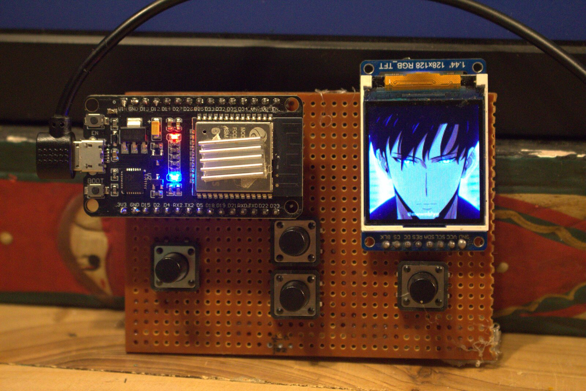
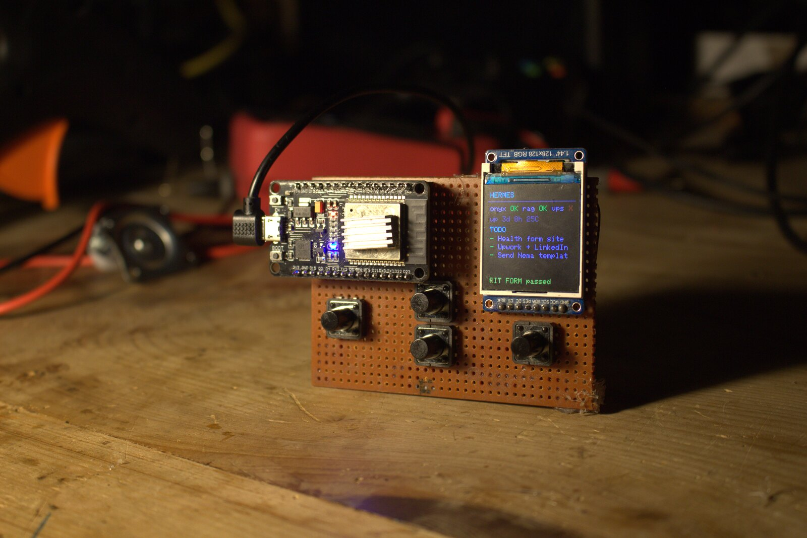

# Hermes Desk Control

Hermes Desk Control is a small, LAN-connected desk display built around an ESP32 and a 128×128 ST7735 TFT. A Python service provides display frames and dashboard data; the ESP32 handles the screen, buttons, Wi-Fi setup, and rendering.

## Demo

[](assets/hermes-desk-demo.mp4)

Select the preview to open the 34-second demo video. The README copy is resized and compressed from the original footage; [open or download the MP4](assets/hermes-desk-demo.mp4).

## The device

| Animated media | Status dashboard |
|:--:|:--:|
|  |  |

## Features

- Six display modes: `face`, `video`, `gif`, `image`, `data`, and `layout`.
- A button-driven on-device menu for changing modes and reopening Wi-Fi setup.
- A Wi-Fi configuration portal for setting the network and Python server URL.
- Remote display settings for screen rotation, backlight brightness, and accent color.
- A dashboard for service reachability, process status, uptime, load, temperature, todos, and configured countdowns.
- Custom screen layouts described as JSON draw operations.
- Runtime media reloads when the configured image, GIF, or video file changes.

## How it works

```text
Python service (port 8090)                 ESP32 + ST7735 display
┌──────────────────────────┐   HTTP       ┌──────────────────────────┐
│ /panel  JSON status/config├─────────────►│ Polls every 5 seconds     │
│ /frame  RGB565 pixel data ├─────────────►│ Draws frames or dashboard│
│ /set    update settings   │◄─────────────┤ Sends menu selections    │
└──────────────────────────┘              └──────────────────────────┘
```

The server exposes three routes:

- `GET /panel` returns the active mode, menu, settings, status values, todos, countdowns, and layout operations.
- `GET /frame` returns one 128×128 RGB565 frame as binary data. The device requests frames continuously in face, video, GIF, and image modes.
- `GET /set` updates the mode or display settings through query parameters.

Video and GIF frames are decoded and held in memory by the server. Keep media clips short and reasonably sized, especially on a low-memory host.

## Hardware

The firmware targets an ESP32 and a 128×128 ST7735 TFT, initialized as `INITR_144GREENTAB` in the Arduino sketch.

| Display / control | ESP32 pin |
|---|---:|
| TFT CS | GPIO 5 |
| TFT DC | GPIO 2 |
| TFT reset | GPIO 4 |
| TFT SCL / SCK | GPIO 18 |
| TFT SDA / MOSI | GPIO 23 |
| TFT backlight | GPIO 21, or 3.3 V for full brightness |
| Menu button | GPIO 32 |
| Up button | GPIO 33 |
| Down button | GPIO 13 |
| Select button | GPIO 14 |

Connect TFT VCC to 3.3 V and all grounds together. Each button connects its listed GPIO to ground; the firmware enables the ESP32's internal pull-up resistors.

## Setup

### 1. Start the Python service

Run the service on a computer on the same Wi-Fi network as the ESP32. Python dependencies are Flask, Pillow, NumPy, and PyAV; `psutil` is optional and supplies temperature readings when supported by the host.

```bash
python3 -m venv .venv
source .venv/bin/activate
python -m pip install Flask Pillow numpy av psutil
python panel_server.py
```

The service listens on `0.0.0.0:8090`. Find the host's LAN IP address; the device must use that address rather than `localhost`.

The service reads its configuration and media from the home directory of the account running it:

| File | Purpose |
|---|---|
| `hermes_cfg.json` | Mode, rotation, brightness, and accent color |
| `ragnar_todos.json` | Dashboard todo list |
| `hermes_layout.json` | Custom layout draw operations |
| `clip.mp4` | Video mode source |
| `face.gif` | GIF mode source |
| `panel_image.png` | Image mode source |

The `panel.py` helper functions can update todos, settings, layouts, and media. Its file paths are currently hardcoded to `/home/phantom`; change those constants if the service runs under a different account so both scripts use the same files.

### 2. Configure and upload the ESP32 firmware

Open `hermes_desk_control.ino` in Arduino IDE, install the libraries below, select the appropriate ESP32 board and port, then upload the sketch.

- Adafruit GFX Library
- Adafruit ST7735 and ST7789 Library
- ArduinoJson v7
- WiFiManager

Use ESP32 Arduino core 3.x or later for the `analogWrite` backlight control used by this sketch.

The firmware's default server URL is `http://192.168.10.2:8090/panel`. Change `DEFAULT_URL` in the sketch to match the service host before uploading, or configure it through the Wi-Fi portal. The device derives `/frame` and `/set` URLs from this base address.

At first boot, or when Wi-Fi credentials are unavailable, the firmware opens a setup access point named `Hermes-Setup` with password `hermes123`. Join it and enter the Wi-Fi credentials and full `/panel` URL. Hold Select while powering on to force the setup portal; it can also be opened from the device menu.

### 3. Use the controls

Press Menu to open or close the mode menu. Use Up and Down to move through the options, then Select to choose one. Select **WIFI SETUP** to update the network or server URL.

## Modes and controls

| Mode | Behavior |
|---|---|
| `face` | Animated face; switches expression based on the configured service checks. |
| `video` | Loops frames from `~/clip.mp4`. |
| `gif` | Loops frames from `~/face.gif`. |
| `image` | Displays `~/panel_image.png`. |
| `data` | Draws service status and up to eight todo entries on the ESP32. |
| `layout` | Draws up to 24 custom operations supplied by the server. |

The helper API in `panel.py` can be called from another local Python script:

```python
from panel import set_media, set_mode, set_layout, update_todos

update_todos(["Review build", "Check network"])
set_mode("data", rotation=0, bright=200, accent="00FFFF")
set_layout([
    {"t": "text", "x": 6, "y": 10, "v": "Hello", "c": "00FFFF", "s": 1},
    {"t": "rect", "x": 4, "y": 24, "w": 120, "h": 40, "c": "FFFFFF"},
])
set_media("/path/to/short-clip.mp4")
```

Supported layout operation types are `fill`, `text`, `rect`, `line`, `hline`, `vline`, `dot`, and `circle`. Coordinates are in pixels on the 128×128 screen. Colors use six-digit RGB hex strings without a leading `#`.

## Host-specific settings

The status checks in `panel_server.py` are currently configured for process name `hermes` and TCP host `87.99.132.132` on port `22`. Update `RAGNAR_PROC`, `VPS_IP`, and `VPS_PORT` to match the services you want to monitor.

**Current code note:** `panel_server.py` calls `countdowns()` from `/panel`, but the `COUNTDOWNS` mapping definition is commented out. Define it (an empty `{}` is valid when there are no countdowns) before using the service; otherwise `/panel` requests raise a `NameError`.

## Repository contents

```text
hermes_desk_control.ino   ESP32 firmware
panel_server.py           Flask HTTP service and frame renderer
panel.py                  Local Python helper functions
assets/                   README photos and compressed demo clip
```
